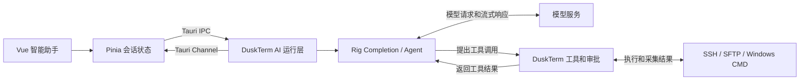

# 智能助手架构

[返回 README 的智能助手章节](../README.md#智能助手)

DuskTerm 在 Vue 界面和 Rig 之间封装了会话管理、模型接入、上下文、终端工具和任务恢复。普通对话使用 Rig Completion，涉及终端操作时使用 Rig Agent。终端连接、工具审批和任务状态由 DuskTerm 管理。

## 总体结构

| 层 | 职责 | 代码入口 |
| --- | --- | --- |
| 前端状态和通信 | 管理当前会话、工作区、草稿、模型选择和生成状态。发送时携带请求 ID 和适用的终端目标，按请求 ID 与事件序号接收流式更新。 | [助手状态](../src/stores/ai.js)、[助手面板](../src/components/ai/AiPanel.vue) |
| 请求入口和运行 | 校验模型接收端、会话及任务目标。按请求选择普通对话、终端任务、任务续跑或解读已有结果，将正文、思考、审批和工具进度回传前端。 | [Tauri 命令](../src-tauri/src/ai/mod.rs)、[任务入口](../src-tauri/src/ai/diagnosis.rs)、[生成运行时](../src-tauri/src/ai/runtime.rs) |
| 模型接入 | 管理模型服务、API 地址、协议、代理、超时、思考参数和模型能力。API Key 存系统凭据库。DuskTerm 获取并解析模型列表，聊天通过按服务配置创建的 Rig 客户端发出。 | [服务接入](../src-tauri/src/ai/provider.rs)、[协议兼容](../src-tauri/src/ai/compatibility.rs)、[输入预算](../src-tauri/src/ai/config.rs) |
| 上下文 | 组织用户消息、有效历史、摘要和工具结果。用户可以把终端选区或近期输出带入可编辑的草稿。长对话按输入预算压缩，变更模型接收端后，发送历史前需要重新确认。 | [终端文本快照](../src/utils/terminalContextSnapshot.js)、[草稿上下文](../src/utils/aiContext.js)、[生成运行时](../src-tauri/src/ai/runtime.rs) |
| 终端工具与审批 | 按连接类型和可用能力注册工具，校验目标、参数、读取范围和审批结果，再调用实际的 SSH、SFTP 或 Windows CMD 执行器。 | [工具注册和调度](../src-tauri/src/ai/tools.rs)、[命令与审批](../src-tauri/src/ai/exec_access.rs)、[文件读取](../src-tauri/src/ai/read_access.rs) |
| 持久化与恢复 | 将会话、工具步骤、用量和检查点保存到本机。长任务可以在批次间续跑。变更结果未知时，按终端目标保存待核实状态，跨会话保留。 | [任务状态](../src-tauri/src/ai/diagnosis.rs)、[SQLite 存储](../src-tauri/src/ai/storage.rs) |

## 一次请求怎么跑

1. 用户发送消息后，Pinia 通过 Tauri 的 `ai_send` 提交请求。支持工具调用的模型可以使用当前绑定的 SSH 或 Windows CMD。工具不可用时，自动绑定的请求可以降级为普通对话，并在界面显示原因。
2. Rust 加载会话和模型设置，准备历史、摘要、终端文本及工具结果，并按模型预算构造本次请求。旧历史要发往新的服务地址或协议时，需要先确认接收端。
3. 普通对话由 Rig Completion 流式生成。终端任务通过 Rig 的 `ToolServer` 装配可用工具，并由 Rig Agent 运行多轮调用。DuskTerm 通过 `AgentHook` 在调用前检查审批和预算，在调用后记录实际结果。
4. 实际命令通过专用执行通道运行。工具把退出状态、输出或查询结果交给模型，模型据此决定下一步。界面同步显示工具状态、审批和回答，Rust 保存会话和检查点。

当前使用的版本以 [Cargo.toml](../src-tauri/Cargo.toml) 为准。应用复用 `rig-core` 的模型请求与流式接口、`rig-agent` 的工具注册与多轮循环、`rig-memory` 的上下文压缩能力，以及 `rig-reqwest` 的 HTTP 传输适配。

## 终端工具的范围

| 能力 | 当前支持 |
| --- | --- |
| 工作目录 | 可核实、切换或列出任务目录。SSH 简单系统命令可用登录默认目录。项目命令和相对路径需要明确目录。 |
| 命令执行 | SSH 按当前对话的审批模式及命令知识库处理。Windows CMD 使用模型设置。 |
| 远程文件 | 通过 SFTP 在获准范围内列目录、读文件、搜文本和筛日志。小型文本修改先预览差异，批准写入后复核原文件并验证写入结果。 |
| 固定脚本 | 查找或用 `@` 指定本地登记的 Skill。执行时核对入口、版本、参数和目标，再按脚本审批流程执行。 |

新对话首次绑定 SSH 目标时使用全局默认模式。切换目标后，对话回到「请求审批」。两种模式都核对命令知识库，命中敏感或危险规则，或知识库缺失、读取或解析失败时，转人工确认。文件读取范围、远程文件写入和固定脚本各有审批规则。带入聊天的终端文本属于用户可编辑的快照。

工具相关实现见[目录管理](../src-tauri/src/ai/terminal_directory.rs)、[文本修改](../src-tauri/src/ai/text_edit.rs)和 [Skill 管理](../src-tauri/src/ai/skill.rs)。本地脚本配置见 [README 的注册终端 Skill 章节](../README.md#注册终端-skill)。

## 任务结束和恢复

- 同一条助手消息呈现结论、关键证据和阻碍。详细命令、输出和历史证据放在可展开的执行记录中。等待审批的记录自动展开。
- 后续问题直接从输入框发送。应用提供有界的历史终端记录并标明目标是否匹配，模型根据本轮意图判断是解释已有结果还是使用终端工具。
- 有待核实的变更时，原助手消息显示「核实结果」。用户在终端核对并确认后，应用同时更新操作的人工核实记录和待核实索引。

会话记录和任务检查点存于 `~/.duskterm/ai.db`。模型调用摘要记录在 `~/.duskterm/logs/ai-calls.jsonl`，记录阶段、结果和用量等元数据。具体字段见[调用日志](../src-tauri/src/ai/call_log.rs)和[数据类型](../src-tauri/src/ai/types.rs)。

## 示例：通过 SSH 安装 Vim

1. 用户在绑定 SSH 目标的对话中说「帮我安装 Vim」。
2. [助手提示词](../src-tauri/src/ai/prompts/assistant.md)引导模型检查发行版并选择包管理器。简单系统命令可在 SSH 登录默认目录运行。
3. DuskTerm 检查对话审批模式和知识库。需要人工确认时，界面显示目标、命令、目录和用途。
4. 模型根据安装命令的结果提出验证检查。最终回答根据退出状态和验证输出说明 Vim 是否安装成功以及遇到的阻碍。

在这个过程中，目录准备由提示词和工具定义引导，审批由 DuskTerm 的执行策略处理。结论和可展开记录由[助手消息组件](../src/components/ai/AiMessage.vue)展示。
